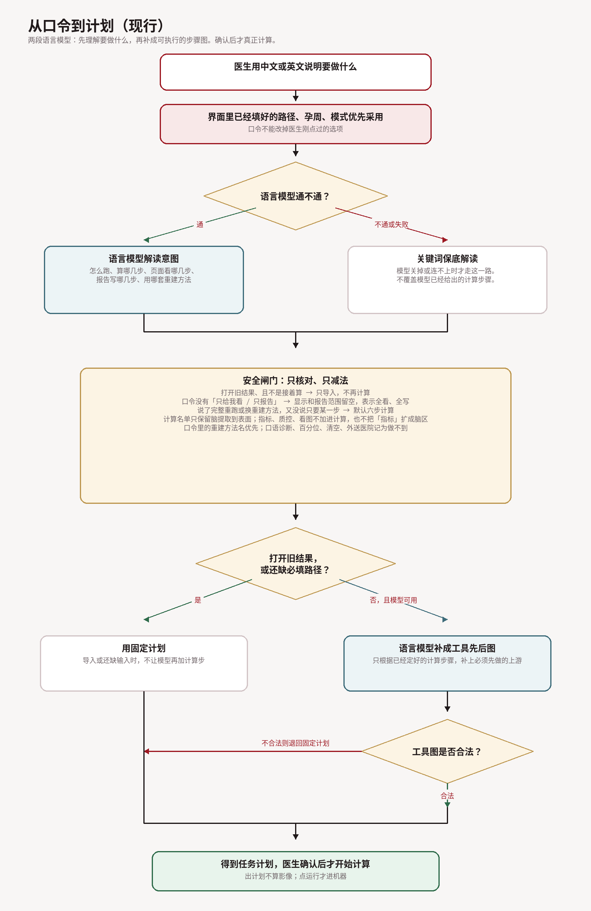
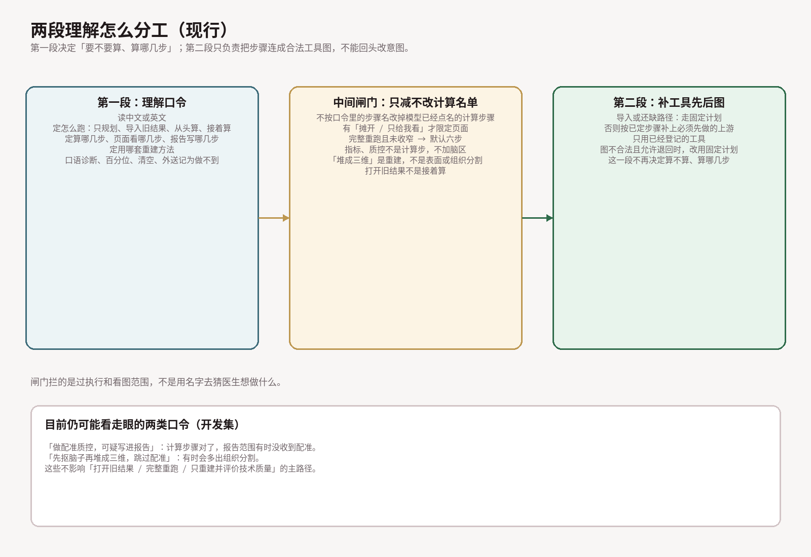
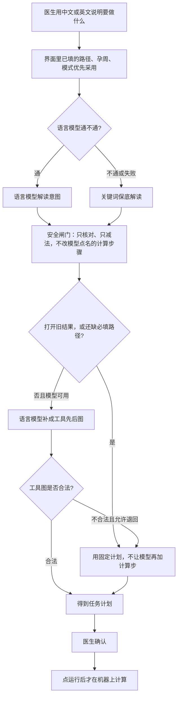

# 自然语言到计划：现行流程、评测暴露的缺陷、修复计划

工程笔记。数字来自 EXP-001 开发集试跑（`validation_runs/exp001_current`，非 locked）。不得写入 CLAIM / RES。

插图反映现行代码，节点用白话，不用函数名。重画：`python docs/notes/figures/render_nl_to_plan.py`。

## 1. 现行流程

两段语言模型：

1. **第一段只理解口令**：怎么跑、算哪几步、页面看哪几步、报告写哪几步、用哪套重建。不跑影像。
2. **第二段只补工具先后图**：按已经定好的计算步骤补上必须先做的上游。打开旧结果或还缺路径时走固定计划，不让模型加计算步。

中间闸门（现行）：

| 规则 | 现行行为 |
| --- | --- |
| 意图以模型为准 | 模型成功则采用它给出的计算 / 显示 / 报告范围；不按口令里的步骤名再改一遍计算名单 |
| 保底解读 | 模型关掉、连不上或调用失败，才改用关键词规则 |
| 界面已填项 | 医生刚点过的路径、孕周、模式优先于口令和模型 |
| 计算名单 | 只保留脑提取到表面这六步；丢掉指标、可视化；不把「指标」扩成脑区；不补模型没点名的上游（补上游是第二段的事） |
| 空的计算名单 | 在「从头算 / 接着算」下，模型也返回空 → 默认六步 |
| 空的显示 / 报告 | 口令没有「只给我看 / 只报告」时留空，表示全看、全写；有这类限定时才用模型给出的列表 |
| 做不到的事 | 关键词和模型给的码合并；否定说法不记；口语诊断、百分位、清空、外送医院也记为做不到 |
| 重建方法 | 口令里的方法名优先；否则用模型给出的合法方法；都没有则用 FROST |
| 确认后才算 | 出计划不算影像；医生点运行才进机器 |

## 2. 实验呈现的缺陷

上图是现行分工。下面数字来自早期开发集试跑，用来说明当时为什么加闸门，不是当前线上指标。

当时 Full Strict **76.7%** = Intent **76.7%**；DAG **93.4%**。失败集中在三类语料，不是图结构坏了。

### Bug 1 — scope：空列表契约和模型填法不一致（Full Strict 47%）

规范两边都说：display/report 为 `[]` 表示未限定、展示/报告用全部证据。  
模型把口令里提到的计算步抄进 display/report。

例：`重新运行脑提取。` gold 是 display=`[]`、report=`[]`；模型写成 `[extraction]`。  
导入类相反：`只展示 reconstruction` 时，不该限定的 report 也被填成 reconstruction。

去掉步骤别名覆盖之后，旧规则「没有显示/报告动词就把 display/report 置空」不再运行，这类全部暴露。

### Bug 2 — coverage_gap：口语拒绝和后端别名（Full Strict 51%）

拒绝码正则对不上口语，模型也没补码：

- `这例发育得好不好？` / `脑子长得行不行` → 应收 `normality_*`，得到 `[]`
- `和同龄胎儿比一比谁大谁小` → 应收百分位拒绝
- `把工作目录清空` / `wipe previous runs` → 应收 `destructive_*`
- `把报告甩到医院 PACS` → 应收 `external_hospital_*`（现正则要「发送…医院」，对不上「甩到 PACS」）

后端：`SVRTK`、`nifty-mic` 三次全是 frost。原因有两层——规则 `\b(auto[-_ ]?svrtk|niftymic|…)` 吃不到这些写法；LLM 分支又不采用模型给的 `reconstruction_tool`。

### Bug 3 — medical_semantics：拒绝对了，步骤多了（Full Strict 69%）

`只重建并评价技术质量` gold 是 extraction+reconstruction，计划带上 roi。  
`registration QC` 多了 roi，report 多了 metrics/visualization。  
Planner 闭包不会凭空加 roi；是 Coordinator 的 execution_steps 已经多写。

## 3. 修复计划

不恢复「步骤别名覆盖 LLM 的 execution_steps」。三条分开修。

| 优先级 | 缺陷 | 改什么 | 验收 |
| --- | --- | --- | --- |
| P0 | scope 空列表 | 口令没有显示/报告限定时，display/report 置 `[]`（未限定=全量）。有「只展示/只报告」时才信模型列表。提示词写明：未提及显示或报告时必须返回空数组 | `scope_*` Full 三次重复 Strict 全部过 |
| P0 | 后端别名 | LLM 合法 `reconstruction_tool` 写入请求；规则别名加上 `svrtk`、`nifty-mic` / `nifty mic` | `gap_12/13/14` 三次均为对应后端 |
| P0 | 口语拒绝 | 扩充 `REFUSAL_CODES` 模式（发育好不好、谁大谁小、清空目录、wipe、甩到 PACS）；提示词要求口语诊断/删除/外送必须给码 | `gap_15–20` 挂上 gold 拒绝码 |
| P1 | 过执行 | Coordinator 提示：execution 用最小可执行集，禁止把「指标/QC/报告」扩成 roi/tissue；补回归：只重建、只 registration QC | `medical_04/07/11` 不再多步 |
| P1 | 评测对照 | 修完后只重跑这三类（约 48 条 × 4 条件），不把开发集率写入 RES | 分类 Strict 相对本试跑上升；全量 960 可选 |

P0/P1 已落地：`coordinate_with_llm` 在无显示/报告限定时强制 `[]`；规则别名覆盖 `svrtk`/`nifty-mic`，LLM 合法 `reconstruction_tool` 会写入请求（口令别名仍优先于模型 frost）；口语拒绝正则与提示词已扩；execution 提示最小可执行集。不恢复步骤别名覆盖 `execution_steps`。P1 评测对照（只重跑三类）未做。
