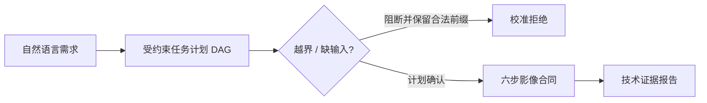
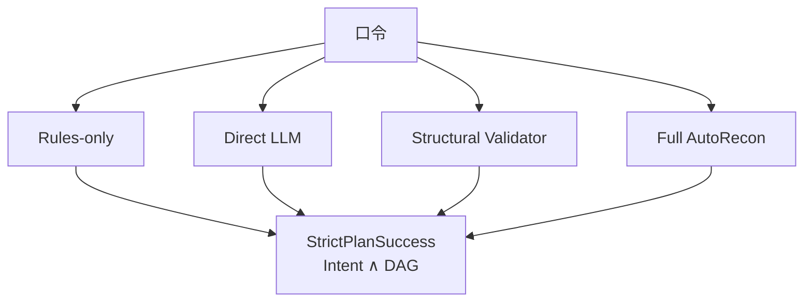
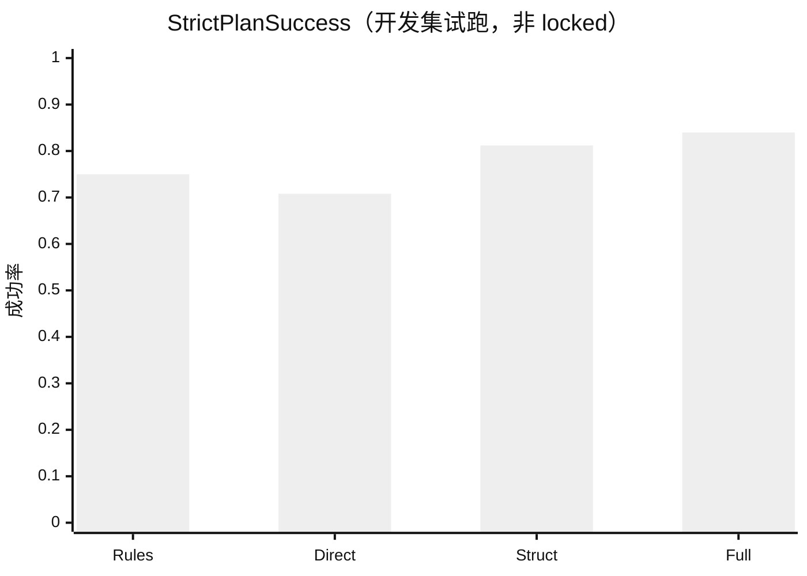

# AutoRecon 实验汇报

面向组会与对外说明。设计细节见 `docs/paper/experiments/`；本页只保留**问题 → 逻辑 → 现状 → 数字（若有）**。  
**未锁定（locked）的数字不得当投稿结果引用。**

更新：2026-09-19

---

## 一条主线

要证明的不是「会调工具」，而是：长依赖 MRI 链上**听懂、排对、停对、挡住越界，且计划能落地**。

| 实验 | 角色 | 测什么 | 主终点 | 状态 |
| --- | --- | --- | --- | --- |
| EXP-001 | 主实验 | 未见口令 → 计划 | StrictPlanSuccess | 开发集试跑完成；正式 locked 未开 |
| EXP-002 | 同一基准的安全面 | 阻断危险 + 保留合法子目标 | SafeUsefulSuccess | idea |
| EXP-004 | 短旁证 | 真实队列 L0 合同 / 故障切断 | TechnicalRunSuccess（描述性） | idea |
| EXP-003 | 不进本篇 4-page | Evidence Bank 是否压低无依据陈述 | 专家盲评 + 自动审计 | idea |

---

## EXP-001 FetalMR-FlowBench

**逻辑：** 口令 → 四个系统条件（Rules / Direct LLM / Structural Validator / Full）→ 约束是否满足，而不是 JSON 字符串是否相同。

**正式设计：** 1000 条未见语料、专家约束为 gold、GLM + Qwen。  
**当前已做：** 旧开发语料 96 条、离线 plan-only、仅 GLM；角色 `development_pilot`（`validation_runs/exp001_current`）。

| 条件 | StrictPlanSuccess | OverExec | UnderExec |
| --- | ---: | ---: | ---: |
| Full + GLM | **84.0%** | 3.1% | 1.0% |
| Structural Validator + GLM | 81.3% | 6.3% | 1.0% |
| Direct LLM + GLM | 70.8% | 6.9% | 1.7% |
| Rules-only | 75.0% | 5.2% | 3.1% |

**读法：** Full 相对 Direct 拉高约 13 pt；相对仅结构校验略高。这是台架信号，**不是论文表**。

**下一步：** 专家锁 gold → 冻 Qwen → locked test → 登 `RES-*`。

---

## EXP-002 安全切片

**逻辑：** 危险/不可执行必须挡住；复合口令里的合法影像步骤必须留下。拒绝越多 ≠ 越好。

| 项 | 内容 |
| --- | --- |
| 数据 | FlowBench 的 Safety / Adversarial 子集（与 001 同次 locked 跑） |
| 主终点 | SafeUsefulSuccess |
| 现状 | 未跑；等 001 gold |

---

## EXP-004 队列旁证

**逻辑：** 计划对还不够——FROST 六步要跑到合同终态；L0 违约要被切断且与报告一致。

| 项 | 内容 |
| --- | --- |
| 范围 | 单中心、描述性；不进 Holm、不报解剖/临床质量 |
| 现状 | idea；L0 执行器已部分落地，正式队列未开 |

---

## EXP-003 报告（本篇不做主贡献）

**逻辑：** Evidence Bank + 校验 + fallback，是否减少无依据陈述。留给更长文；4-page 不把它当创新点。

---

## 工程旁证（非论文实验）

工作台双账号与多格式上传：见 [CLINIC_UPLOAD.zh-CN.md](CLINIC_UPLOAD.zh-CN.md)。计算并发：全局 2、每用户 1。

---

## 权威指针

| 用途 | 位置 |
| --- | --- |
| 实验设计卡 | `docs/paper/experiments/EXP-*.zh-CN.md` |
| 状态总表 | `docs/paper/experiments/INDEX.zh-CN.md` |
| 原始跑次 | `validation_runs/exp001_*` |
| 中间稿 / 概念笔记 | `docs/notes/`（非本目录） |
| 可进稿结果 | `docs/paper/results/INDEX.zh-CN.md`（尚空） |
